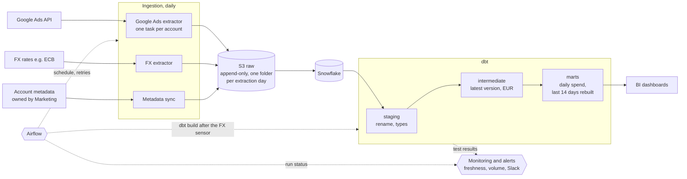
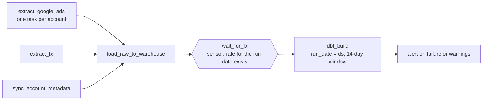
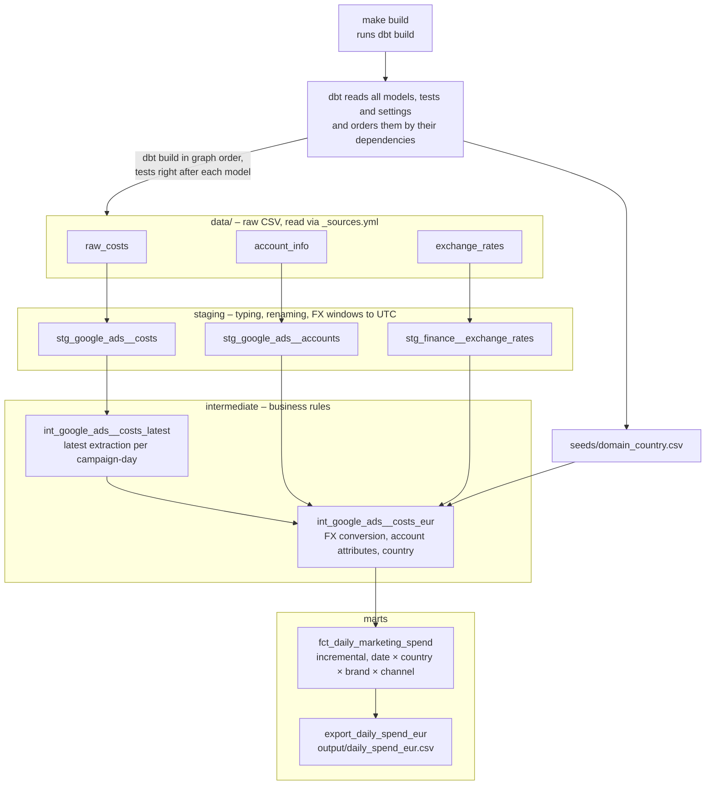

# FLIX – Marketing Spend Pipeline

Daily Google Ads spend in **EUR** by **date × country × brand × channel**, built with **dbt + DuckDB**.

> **Result, January 2025:** 93 rows, **€345,950.02** (DE €182,192 · BR €82,658 · HU €81,099) → `output/daily_spend_eur.csv`

| Section | What you find there |
|---|---|
| [Quick start](#quick-start) | two commands, outputs, other commands |
| [Part A – Production design](#part-a--production-design) | architecture, DAG, scheduling, reliability, monitoring, scalability |
| [Part B – Pipeline](#part-b--pipeline) | data flow, [decisions](#decisions), [incremental logic](#incremental-logic), [data findings](#data-findings), [tests](#tests) |
| [docs/PIPELINE.md](docs/PIPELINE.md) | materialisations, incremental window, all tests, orchestration and CI |
| [docs/DATA_QUALITY.md](docs/DATA_QUALITY.md) | the 5 data issues, each with real rows |
| [docs/SCENARIOS.md](docs/SCENARIOS.md) | the open business rules as dbt variables and their impact on the total |

**Tags used in all documents:** `DECISION` my choice where the brief is open · `ASSUMPTION` to confirm with Flix · `LIMITATION` known gap · `PROD` what changes in production

---

## Quick start

Requirements: uv on a UNIX-like system (`brew install uv` or `pip install uv`).

```bash
git clone https://github.com/tprzybylo3/flix-marketing-spend.git
cd flix-marketing-spend
make setup     # creates .venv with the exact versions from uv.lock
make build     # dbt build: seed, models, data tests, unit tests, CSV export
```

| Output | Content |
|---|---|
| `output/daily_spend_eur.csv` | final dataset for stakeholders |
| `output/marketing.duckdb` | all layers (`duckdb output/marketing.duckdb`) |

| Command | What it does |
|---|---|
| `make full-refresh` | rebuilds every table, ignoring the incremental window |
| `make test-incremental` | simulates late corrections on a temporary copy and checks the window |
| `make scenarios` | rebuilds every business-rule scenario and prints the comparison ([SCENARIOS](docs/SCENARIOS.md)) |
| `make docs` | dbt documentation with the lineage graph, at http://localhost:8580 (other port: `make docs DOCS_PORT=9000`) |
| `make docker-build && make docker-run` | runs `dbt build` inside the Docker image |
| `make clean` | removes generated files |

**Why DuckDB:** the brief allows a local database such as SQLite; DuckDB is the same idea (one file, no server) with a maintained dbt adapter. Models are plain SQL; only the sources (`external_location` reading CSVs) are DuckDB-specific. **Versions:** `uv.lock` pins all 63 packages, so laptop, CI and Docker run identical versions.

---

## Part A – Production design

> **Design only.** Of this part, the repository contains only the `dbt_build` step (`dags/marketing_spend_dag.py`, not executed). Extraction, loading, the FX sensor, monitoring and alerting are not built.

Solid arrows are data; dotted arrows are control (Airflow starting tasks) and observation (monitoring).



Proposed daily DAG (only `dbt_build` exists in the repo):



| Area | Design |
|---|---|
| **Scheduling** | Daily after Google finalises the previous day. Each run rebuilds a **14-day lookback** with idempotent delete+insert or MERGE per date; a backfill is the same job with a date range. A sensor waits for the day's FX rate instead of converting with a missing one. |
| **Late corrections** | `warn_source_newer_than_mart` compares extraction timestamps and reads only newly loaded partitions → backfill of the listed dates. `warn_mart_drift_at_full_grain` compares amounts: last 40 days on every run, the whole history when model logic or the account mapping changes (part of that deploy). Later: with `_loaded_at`, reprocess exactly the dates that received new rows. |
| **Reliability** | Raw layer append-only and immutable, so any day can be replayed. The extractor adds `try_number` and `request_seq` to each row, so "latest" is always unique ([what the source should add](docs/DATA_QUALITY.md#what-the-source-should-add)). API calls retry with backoff, per account, so one failure does not block the rest. Schema contracts at ingestion; dbt tests gate publication. |
| **Retries** | `LIMITATION` the repo DAG retries a failed run twice, also when it failed on a data test, which fails again on every retry and only delays the alert. `PROD` retry only technical failures (dbt exit code 2: crash, lost connection), never failed tests (exit code 1). |
| **Load metadata** | Every raw row should carry the file it came from and its load time (`_loaded_at`), to find and reload a bad delivery. |
| **Monitoring** | Freshness SLA on the mart (e.g. D-1 by 07:00), `dbt source freshness`, volume and spend anomalies per account, test history (e.g. elementary), weekly reconciliation with the Google Ads UI or invoices. An "account stopped spending" check needs account and campaign status (ENABLED, PAUSED, REMOVED) from the API; the sample has no such case, so it is not built. |
| **Alerts** | `on_failure_callback` to Slack; a task after `dbt build` reads warnings from `target/run_results.json` and posts a daily summary. |
| **Deployment** | Terraform for buckets, IAM, secrets, Airflow; pipeline as a Docker image; CI runs `dbt build` on a dev schema per PR. Account → country/brand/channel mapping owned by Marketing as a tested SCD2 table. |

**Scalability**
- **Volume:** one row = one campaign on one day in one extraction, so data grows with the number of accounts and campaigns, not with clicks. Example: 1,000 accounts × 50 campaigns × 30 days × 2 versions ≈ 3 million rows a month, small for Snowflake.
- **Daily cost does not grow with history:** each run rebuilds only the last 14 dates of the mart and compares only the last 40 days for drift; older dates are not touched.
- **Identified in dbt:** most build time goes to data tests, not models; on a view each test recomputes the dedup and FX join. So `int_*` are **tables**, computed once per run. A table still recomputes the whole history daily; `PROD` incremental `int` on campaign-day with the same window, data tests limited to the window (`config: where`), full tests on full refresh, raw partitioned by extraction date and clustered by spend date.

---

## Part B – Pipeline



**`make build`** runs 54 nodes in graph order: 1 seed, 7 models, 8 unit tests (before their model), 38 data tests (after their model). **An error test skips everything downstream**, so the mart and the CSV keep the last good data (e.g. a missing BRL rate fails `not_null_int_google_ads__costs_eur_fx_rate` and the mart is not rebuilt).

Materialisations, the incremental window, the full test list and orchestration in detail: **[docs/PIPELINE.md](docs/PIPELINE.md)**.

### Decisions

Every open rule is a dbt variable with tested alternatives ([SCENARIOS](docs/SCENARIOS.md)). The defaults are set under `vars:` in `dbt_project.yml`: change them there, or for a single run with `dbt build --vars '{tie_break: lowest}'`. A value outside the allowed list stops the build at compile time (`macros/allowed_var.sql`), so a typo cannot silently switch the rule.

| Topic | Rule | Why |
|---|---|---|
| **Latest entry** `DECISION` | newest `LAST_EXTRACTED_AT` **per campaign-day** (spend date × account × campaign); versions are never summed | the brief says each *campaign* is extracted multiple times, and each campaign has its own extraction times. The trap, newest extraction per account-day, loses 42% of spend ([Q1](docs/SCENARIOS.md#q1-grain-of-the-latest-entry)) |
| **Ties** `ASSUMPTION` | 103 campaign-days with two costs at the same timestamp: take the **higher** | conservative, never understates spend; 0.5% of the total; every case reported by `warn_same_timestamp_conflicts` ([DQ #2](docs/DATA_QUALITY.md#2-same-timestamp-ties)) |
| **FX** | `BASE = EUR`, `RATE` = currency per 1 EUR (BRL ≈ 6.1–6.4 in January) → `EUR = local / RATE`; EUR accounts use 1 | rate valid at **noon UTC** of the spend date: windows start 00:00:01 CET, noon avoids midnight and DST off-by-one |
| **Country** `ASSUMPTION` | from account `DOMAIN` via `seeds/domain_country.csv`; unmapped → `UNKNOWN` + warning | no country column in the source. `PROD` block or quarantine instead of `UNKNOWN` |
| **Brand / channel** | `BRAND`, `CHANNEL_TYPE` from account info | `AD_PLATFORM` is Google for all spending accounts ([Q4](docs/SCENARIOS.md#q4-channel)) |
| **Grain** | date × country × brand × channel + `campaign_count` + `last_extracted_at` | `last_extracted_at` shows how fresh a number is; amounts rounded after aggregation |

### Incremental logic

`DECISION` The mart is incremental: every daily run deletes the last 14 spend dates and rebuilds them from the newest versions; older dates stay as they are. A correction that arrives later is not applied but is reported by two warning tests (`warn_source_newer_than_mart`, `warn_mart_drift_at_full_grain`) and repaired by a backfill or `make full-refresh`. `scripts/test_incremental.sh` (in CI) proves all three. Why 14 days, the run table and the drift check: [PIPELINE](docs/PIPELINE.md#incremental-logic).

### Data findings

3,858 cost rows · 3 accounts with spend (DE FlixTrain EUR, HU FlixBus EUR, BR FlixBus BRL) · 304 campaigns · 2,358 campaign-days. Details and real rows: [DATA_QUALITY](docs/DATA_QUALITY.md).

| # | Finding | Size | Handling |
|---|---|---|---|
| 1 | Repeated extractions: Google revises costs up to 9 days later; the newest extraction holds only some campaigns | 1,392 campaign-days with 2 versions (spend dates 1–15 Jan) | latest per campaign-day, 14-day window |
| 2 | Two costs with the same timestamp (`LAST_EXTRACTED_AT` is a batch start) | 103 campaign-days | higher cost, warning |
| 3 | Spend dates 6–7 Jan from a separate 10:45:35 process | 422 rows | no special handling |
| 4 | Extracted before the spend date | 334 rows | superseded later; warning |
| 5 | Exact duplicates | 5 rows | removed by the dedup |

FX table: HRK still listed (Croatia uses EUR since 2023), PEN only from 2025-03-15, rates carried over weekends.

### Tests

Every `make build` runs 38 data tests (errors stop the build, warnings only report) and 8 unit tests; `make test-incremental` adds the integration test. Full list with file locations: [PIPELINE](docs/PIPELINE.md#tests). Orchestration (Airflow DAG, not executed) and CI: [PIPELINE](docs/PIPELINE.md#orchestration-and-ci).

---

## What I would do with more time

| Area | Next step |
|---|---|
| **Agree with Flix** | tie-break rule; country of `com` and `app` domains; whether `AD_PLATFORM` belongs in the breakdown; what the 10:45:35 process and the pre-spend-date extractions are |
| **Source** | `try_number` and `request_seq` from the extractor, so ties disappear; raw files in S3 with `_source_file`, `_loaded_at` |
| **Data quality** | quarantine failing rows instead of stopping the whole build (needs agreement on what may be published partially); freshness and anomaly tests; an `is_final` flag from `last_extracted_at` (a date's value two days after it later moves by −2.6% to +4.9%, 6–7 Jan excluded) |
| **Modelling** | SCD2 account attributes; a campaign-level fact table for drill-down |
| **Orchestration** | dbt from the Docker image (`KubernetesPodOperator`) or Cosmos; sensor on raw data instead of a fixed 03:00; MERGE in the warehouse; CI only on changed models (`state:modified+`) |
